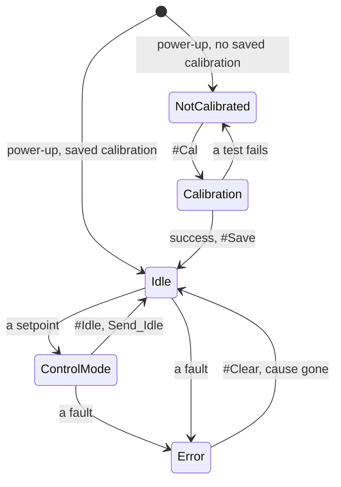

# Control modes

The driver is always in one control mode. A command that carries a setpoint switches to the mode that uses it;
`#Idle` or Send_Idle switches back to idle. The driver refuses every mode except idle, open loop included, while it
is not calibrated or while an error is active.

A setpoint is `#P`, `#V`, `#Iq`, `#PD` or a CAN motion frame, and a new setpoint switches the mode without
passing through idle; a fault is any of the errors on [Errors and recovery](https://docs.source-robotics.com/STEPFOC-docs/109/06-operation/errors/).

| ControlMode | What the motor does | Entered by | Setpoint unit |
|---|---|---|---|
| Idle | nothing: brakes (phases shorted), the default, or coasts (phases open), as set by `#Brake` / `#Coast` or Send_Settings; see [Braking in idle](#braking-in-idle) | `#Idle`, Send_Idle, `#Clear`, errors | — |
| Position | holds and moves to a position with the cascade of position, velocity and current loops | `#P`, Send_data_pack_1 (8 bytes) | encoder ticks |
| Velocity | turns at a speed with the velocity and current loops | `#V`, Send_data_pack_1 (5 bytes) | encoder ticks/s |
| Current (torque) | applies a current, so a torque, with the current loop alone | `#Iq`, Send_data_pack_1 (2 bytes) | mA |
| PD (impedance) | behaves like a spring and a damper around a position, with `KP` and `KD` | `#PD`, Send_data_pack_PD | encoder ticks |
| Voltage torque | applies a voltage on the q axis directly, without the current loop: clamped to `#Vlim`, not current-limited | `#Uq` | mV |
| Open loop | steps the motor like a plain stepper driver, without the encoder and without a current limit; see [Open-loop stepping](#open-loop-stepping) | `#Openloop` (continuous), `#gosteps` (a number of microsteps) | electrical rad/s; microsteps |
| HALL | spins until a sensor on ADDITIONAL2 triggers, then holds the position reached; with a level trigger only while the pin stays at that level | `#HALL`, Send_data_pack_HALL | encoder ticks/s |
| Gripper | runs the gripper state machine: move to a jaw position with a speed and a current limit | `#Grippos`, Send_gripper_data_pack (with `#Gripper 1`) | 0 to 255 |
| Calibration | the calibration routine, and the angle-offset step alone | `#Cal`, `#Calangle`, `#Gripcal` | — |

## Braking in idle

In idle the driver brakes: it keeps both coils shorted through the driver stage, so the motor resists being
turned. It does so at every power-up, and also with an error, which puts the driver in idle.

`#Coast` (or
Send_Settings over CAN) lets the motor coast instead, with the coils open, until the next power-up: `#Save` does
not keep it. `#Brake` brakes again.

!!! warning "The braking current is not limited"
    A motor that is turned while it brakes drives its own back-EMF current through the shorted coils, and the
    current loop does not limit that current. Do not let a load drive a braking motor fast; send `#Coast` first
    when the shaft must turn freely.

## Units

- **Position** is in encoder ticks: 16384 per revolution of the motor shaft, counting up without limit over
  several revolutions. Positive is counter-clockwise seen from the magnet (the back of the motor).
- **Speed** is in encoder ticks per second: 16384 is one revolution per second, 60 rpm.
- **Current** is in mA. Torque is current times the motor's Kt, which calibration finds.
- **Feedforward**: the 8-byte motion frame carries a speed and a current feedforward beside the position, the
  5-byte one a current feedforward beside the speed. They are added after the loops, so a host that knows the
  trajectory can command it directly and leave the loops to correct the rest. Send 0 when you do not use them.

## Try it

  

    <label for="uc-ticks">Ticks (a position, or a speed per second)</label>
    <input id="uc-ticks" type="number" name="ticks" step="1" value="16384">
    <label for="uc-pp">Pole pairs</label>
    <select id="uc-pp" name="pp">
      <option value="50" selected>50 (1.8° stepper)</option>
      <option value="75">75 (1.2°)</option>
      <option value="100">100 (0.9°)</option>
      <option value="125">125 (0.72°)</option>
    </select>
  

  
As a position: <strong data-out="turns">1.000</strong> turns, <strong data-out="deg">360.0°</strong> · as a speed: <strong data-out="rpm">60</strong> rpm · the practical maximum for 50 pole pairs is about <strong data-out="maxrpm">720</strong> rpm

  

    <label for="uc-kt">Kt in Nm/A (what #Kt prints)</label>
    <input id="uc-kt" type="number" name="kt" step="0.01" min="0" value="0.21">
    <label for="uc-ma">Current in mA</label>
    <input id="uc-ma" type="number" name="ma" step="10" value="1000">
  

  
Torque: <strong data-out="nm">0.21 Nm</strong>, <strong data-out="ncm">21 N·cm</strong>

The units of this page, with your numbers: 16384 encoder ticks per turn, the practical speed limit from the
electrical frequency the control loop can follow ([Ratings and limits](https://docs.source-robotics.com/STEPFOC-docs/109/03-technical-data/ratings/)), and
the torque as Kt times the current.

## Open-loop stepping

`#Openloop` and `#gosteps` drive the coils like a plain stepper driver, without the encoder in the loop. Like every
other mode, they need a calibrated driver without errors.

- `#Openloop 50` turns the field at 50 electrical rad/s and keeps turning until another command. On a motor with
  50 pole pairs that is 50 ÷ (2π × 50), about 0.16 revolutions per second.
- `#gosteps 64` makes 64 microsteps, then goes to idle; a negative number goes the other way. `#microstep` (16 by
  default) is the number of microsteps per electrical cycle, which is four full steps: with 16, `#gosteps 16` turns
  a 1.8° motor by 7.2°. `#stepinterval` (1000 µs by default) is the time between two microsteps, rounded down to
  whole control cycles of 160 µs.
- `#Openv` (5000 mV by default) is the voltage both put on the coils.

None of these settings is saved.

!!! warning "Open loop is not current-limited"
    Open loop applies a voltage, not a current, and `#Ilim` does not apply. At standstill and low speed the coil
    current is about `#Openv` ÷ R: the default 5000 mV drives about 4.5 A through a 1.1 Ω coil, more than the
    driver's 2.8 A and the motor's rating. Set `#Openv` to the rated current × R first (2 A × 1.1 Ω = 2200 mV), and
    keep the test short.

## Positive rotation

{ width="700" }
{ width="700" }

## Which mode am I in?

`#Mode` prints the mode: `Idle mode`, `Position control`, `Speed control`, `Current control`, `PD control`,
`Open loop`, `Gripper mode` or `Gripper calib mode`.

In this firmware release the voltage-torque mode reads
`Gripper mode` too (a leftover label), and HALL mode, the angle-offset search (`#Calangle`), open-loop steps
(`#gosteps`), gripper mode and the encoder-table run print nothing. The behaviour of the motor is the reliable check there.
