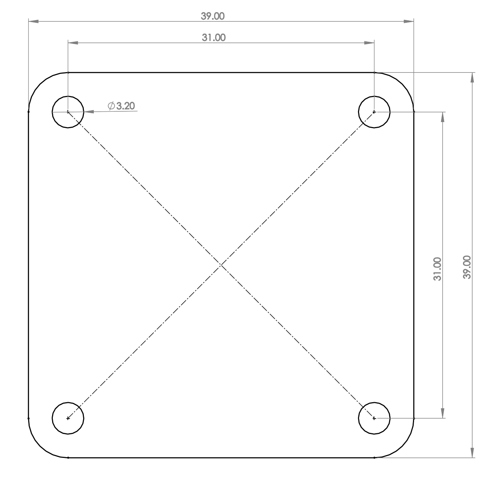
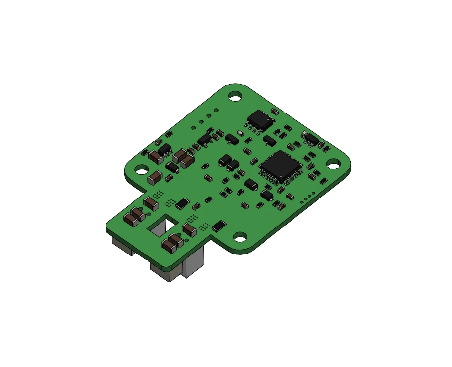

# Dimensions and CAD

The board is 39 × 39 mm with the four mounting holes on the NEMA 17 pattern (31 mm apart), so it bolts to the back
of a NEMA 17 motor with the motor's own screws and a spacer. The encoder chip is exactly in the middle of the board,
on the motor shaft's axis.

  <canvas class="gripper-viewer__canvas" aria-label="The STEPFOC driver in 3D: drag to turn, scroll to zoom"></canvas>
  

    <button type="button" name="reset" class="md-button">Reset view</button>
  

  
Drag to turn the board, scroll to zoom. The model is the board's STEP file from the <a href="https://github.com/Source-Robotics/STEPFOC-stepper-controller/tree/main/STEP%20files">repository</a>, the PCB and everything mounted on it.

<figure markdown="span">
  { width="600" }
  <figcaption>Figure 3: Board dimensions and hole pattern. The drawing is of the Spectral Micro, which has the same board.</figcaption>
</figure>

<figure markdown="span">
  { width="520" }
  <figcaption>Figure 4: The STEP model.</figcaption>
</figure>

The STEP files of the board, the magnet spacers for different motor lengths and the tool for pressing the magnet
onto the shaft are in the firmware repository:

- [STEP files](https://github.com/Source-Robotics/STEPFOC-stepper-controller/tree/main/STEP%20files) of the board
- [Stepper motor accessories](https://github.com/Source-Robotics/STEPFOC-stepper-controller/tree/main/STEP%20files/Stepper%20motor%20accessories):
  magnet spacers, NEMA 17 spacers for different motor lengths, NEMA 23 spacers
- [Tools](https://github.com/Source-Robotics/STEPFOC-stepper-controller/tree/main/STEP%20files/Tools): the magnet tool

[CAD and downloads](../cad-files.md) lists everything that can be downloaded.
