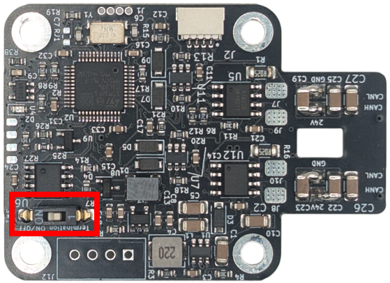

# STEPFOC datasheet

!!! note "Spectral micro BLDC driver and STEPFOC driver"
    **STEPFOC stepper driver is built on the same hardware and software foundation as the Spectral Micro BLDC driver. As a result, some references or images in this documentation may still show the Spectral Micro, since both drivers share about 99% of their features. They also use the same CAN and UART command sets, with only minor differences in UART-based calibration and setup procedures.**  

**STEPFOC** is a FOC based stepper motor controller designed to deliver affordable, high-performance hardware paired with powerful open-source software. Its mission is to transform low-cost stepper motors into high-performance robotic servos, enabling advanced robotics applications without the high price tag.

The controller features a 14-bit magnetic encoder, inline current sensing, CAN and UART interfaces, and supports position, velocity, torque, and impedance control modes — everything you need to build precise and capable robotic systems.

Optimized for NEMA17 stepper motors, STEPFOC provides a complete solution for robotics development.

   |   |   Features
    ---- | ---- 
    
    
 | **Electrical specs**    - Stepper motor FOC controller    - Voltage input: 12 - 29V      - Max continuous phase current: 2.8A    - Max phase current: 2.8A (with good cooling)    - Inline current sensing    - PWM switching rate: 25 kHz    - Max power: 80W     - Idle power: 0.3W    - Control loop frequency: 6250Hz      - Max electrical frequency: 460 Hz        **Mechanical specs**     - Mass: 8 g      - Dimensions: 39mm x 39mm    - Nema 17 compatible mounting hole distances      **Features**  - STM32f103c microcontroller  - 14 bit encoder    - CAN and UART communication   -  Daisy chain CAN and power connector     - EEPROM memory 16 Kbit    -  Hardware overcurrent, over-under voltage and temperature protection     - Fully open source firmware and support for SimpleFOC    - One additional pin for hall sensor    - Temperature sensor connector   -  Torque, velocity, position, and Impedance control modes   -  Auto calibration features   -  Connector for a step / dir interface (hardware only; the firmware does not support step / dir)
  
!!! tip "Each STEPFOC Stepper controller is Fully end of line tested."

## Absolute maximum ratings

* Supply voltage -> min 12V, typ 24V, max 29V
* Phase current -> typ 1.5 A, max 2.8 A (the firmware limit), with good cooling and in short bursts
* Operating Temperature -> min -20°C, typ 25°C, max 130°C

## Connectors

Connector | Cable assembly | Connector datasheet
---- | ---- | ----
UART | [UART cable](https://source-robotics.com/products/uart-cable) | [JST SH series](https://www.digikey.com/en/product-highlight/j/jst/sh-and-sr-series-connectors)
Power | [Power cable](https://source-robotics.com/products/spectral-micro-power-cable) | [JST XH series](https://www.digikey.com/en/product-highlight/j/jst/xh-series-connectors)
CAN | [CAN cable](https://source-robotics.com/products/spectral-micro-can-cable?variant=47694678655324) | [JST ZH series](https://www.digikey.com/en/products/detail/jst-sales-america-inc/ZHR-2/566476)
JTAG | [Programming adapter](https://source-robotics.com/products/jtag-programming-adapter-1-27-pitch?variant=47293352903004) | 1.27 pitch pin header

## Pinout

!!! danger "Reversing the polarity on DC+ and DC- will destroy the board."

Motor phases are connected to A+, A-, B+ and B-. Power is connected to DC+ and DC-

    

!!! note "Note!"

    * thermistor pin is using pulldown of 54.9 kilo ohms. 
    * UART is 3v3 only. Using 5V will destroy the board.
    * "ADDITIONAL2" can be used as analog input or general purpose input/output

## CAD and dimensions

[Download the STEPFOC STEP files](https://github.com/Source-Robotics/STEPFOC-stepper-controller/tree/main/STEP%20files)

    

STEPFOC uses same hole spacing as NEMA17 format motors.
!!! note "Magnetic encoder is located exactly at the middle of the board!"

    

## CAN termination

To use CAN termination make sure to place the switch in **ON** position!

    

## Pre loaded firmware

!!! note "Preloaded firmware"
    STEPFOC comes preloaded with the STEPFOC firmware. You can check which release is on your driver over UART with the command #Info

Default settings that come preloaded are:

- LED indication: 1  
- Calibrated: 0
- Using thermistor: 0
- Watchdog active: 0
- Heartbeat active: 0
- UART baud rate: 256000
- CAN baud rate: 1000000
- Default CAN node ID: 0
- I AM GRIPPER: 0

- Pole pair: 0
- Resistance: 0
- Inductance: 0
