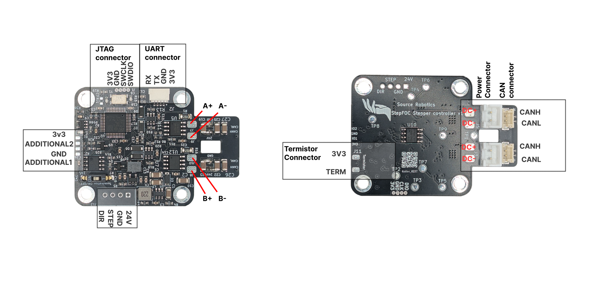

# Wiring the stepper

A bipolar stepper has two coils and four wires. One coil goes to the terminals **A+ and A−**, the other to **B+
and B−**. Which coil is A and which is B does not matter, and neither does the polarity of each coil: firmware 105
and newer finds the wiring during calibration and compensates it.

<figure markdown="span">
  { width="900" }
  <figcaption>Figure 7: The motor terminals A+, A−, B+, B− and the other connectors.</figcaption>
</figure>

## Finding the two coils

With a multimeter on the resistance range, the two wires of one coil show the coil's resistance, a few ohms; two
wires of different coils show no connection. Pair the wires that way. Most datasheets also name the pairs (A/C and
B/D, or the colours).

## Soldering

1. Cut the leads to a comfortable length: long enough to reach the pads with the board mounted, short enough not to
   get into the motor's shaft. If your firmware is older than 105 (see [Releases and versions](../07-firmware/releases.md)),
   leave them long enough to swap one pair later.
2. Tin the leads and solder them to the pads: one coil to A+ and A−, the other to B+ and B−.
3. Make sure no strand bridges two pads and that nothing touches the motor housing.

!!! warning
    Never connect or disconnect the motor while the driver is powered.

## Phase order and direction

Calibration spins the motor in open loop and watches the encoder. With firmware 105 and newer, a reversed coil is
detected and compensated in software (the firmware applies a reflection of the current frame, which is what a
physical swap would do), so the motor calibrates identically with any wiring, and positive commands turn the motor
counter-clockwise seen from the magnet side. With firmware 103, a reversed coil fails the open-loop step with
`Open loop: Failed / Switch motor phases and try again!`; swap A+ and A− and calibrate again.

If you want the other direction to be positive, swap the two wires of one coil and calibrate again, or keep the
wiring and use negative setpoints.
