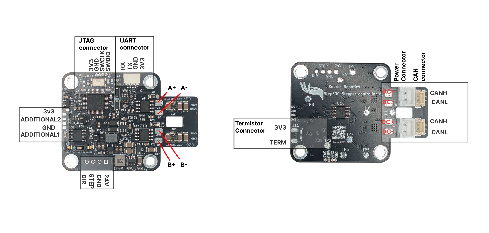

# Wiring the stepper

A bipolar stepper has two coils and four wires. One coil goes to the terminals **A+ and A−**, the other to **B+
and B−**. Which coil is A and which is B does not matter, and neither does the polarity of each coil: firmware 105
and newer finds the wiring during calibration and compensates it.

{ width="900" }

## Finding the two coils

On most stepper motors the colours give the pairs away: **black and green** are one coil, **red and blue** the
other. The Stepperonline motors of [Tested motors](../03-technical-data/tested-motors.md) are wired that way:
black to A+, green to A−, red to B+, blue to B−.

| Coil | Usual wire colours | Terminals |
|---|---|---|
| A | black, green | A+, A− |
| B | red, blue | B+, B− |

Not every maker follows it, so check with a multimeter on the resistance range: the two wires of one coil show the
coil's resistance, a few ohms; two wires of different coils show no connection. Most datasheets also name the
pairs (A/C and B/D, or the colours).

## Soldering

1. Cut the leads to a comfortable length: long enough to reach the pads with the board mounted, short enough not to
   get into the motor's shaft. If your firmware is older than 105 (see [Releases and versions](../07-firmware/releases.md)),
   leave them long enough to swap one pair later.
2. Tin the leads and solder them to the pads: one coil to A+ and A−, the other to B+ and B−.
3. Make sure no strand bridges two pads and that nothing touches the motor housing.

!!! success "Check"
    With the driver unpowered, a multimeter shows the coil's resistance, a few ohms, between A+ and A− and
    between B+ and B−, and no strand bridges two pads.

!!! warning
    Never connect or disconnect the motor while the driver is powered.

## Phase order and direction

Calibration spins the motor in open loop and watches the encoder.

With firmware 105 and newer, a reversed coil is
detected and compensated in software (the firmware applies a reflection of the current frame, which is what a
physical swap would do), so the motor calibrates identically with any wiring, and positive commands turn the motor
counter-clockwise seen from the magnet side.

With firmware 103, a reversed coil fails the open-loop step with
`Open loop: Failed / Switch motor phases and try again!`; swap A+ and A− and calibrate again.

Because calibration compensates the wiring, the positive direction is tied to the encoder: with firmware 105 and
newer, swapping the wires of a coil and calibrating again does not change it.

The firmware has no setting that
reverses it (`#Dir` is stored but not used). If you want the other direction to be positive, negate the setpoints
and the position, speed and current you read back in your host program.
