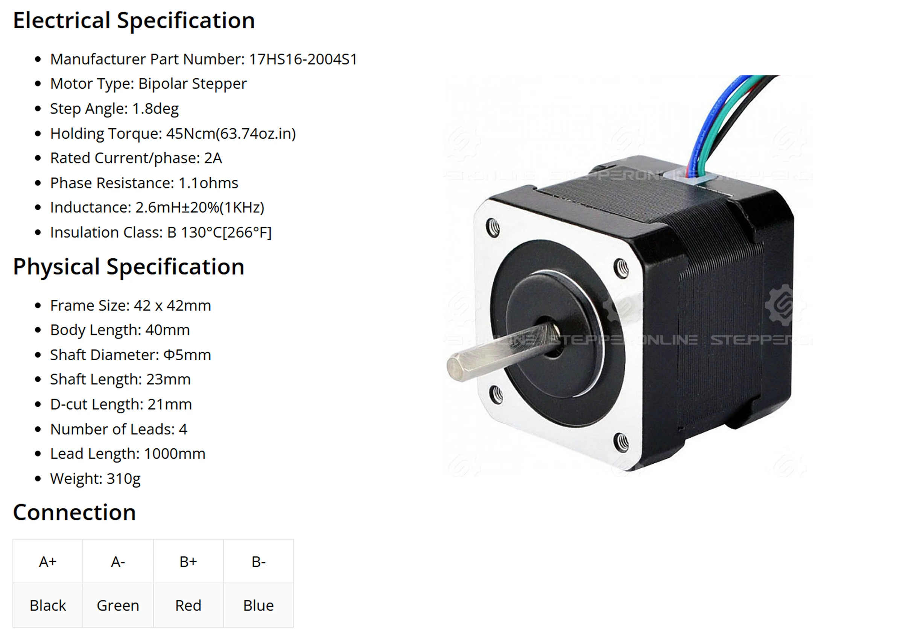

# Motor parameters and calibration

Calibration teaches the driver its motor: it checks the magnet and the supply, takes the motor's resistance,
inductance and pole pairs from you, computes the current loop gains, spins the motor in open loop to learn the
direction of the wiring, finds the angle offset between the encoder and the motor's electrical zero, and measures
the motor constants Kt, KV and the flux linkage. From firmware 109 two more runs follow by themselves, the
[encoder table and the anti-cogging](anti-cogging.md), and then the driver saves everything. It runs once per
motor; the result is kept by saving.

!!! danger "The motor turns"
    Calibration spins the motor in both directions, fast at times. Fix the motor to the bench and take everything
    off the shaft.

!!! tip "Supply voltage"
    Calibrate at 24 V. At a lower voltage the KV and Kt come out wrong.

## 1. Restore the defaults

The EEPROM of a new driver, or of one that ran another motor, can hold values that do not fit, such as another
motor's parameters. Calibration starts from what is there, so start from the factory values. (A damaged
configuration should not show up with firmware 106 and newer, which checks the stored blocks at power-up and
replaces a damaged one with the defaults; if `#Info` still shows `-1` somewhere, restoring the defaults fixes it.)

=== "Motor GUI"
    *Default* in the settings.

=== "Terminal"
    ```
    #Default
    ```

This also resets the serial number, hardware version and batch date stored in the EEPROM, and clears an
encoder table and an anti-cogging set from another motor; note the hardware version and batch date `#Info`
prints if you need them. From firmware 109 the CAN node ID is kept. [Saving the configuration](saving.md) says
what else it does.

## 2. Enter the motor parameters

STEPFOC does not measure the resistance and inductance of a stepper (the Spectral Micro does for a BLDC); you
enter them from the motor's datasheet, as the values of **one coil**, and the pole pairs. Calibration fails on a
value left at 0, and accepts only 50, 75, 100 or 125 pole pairs.

=== "Motor GUI"
    In the motor settings enter *Pole pairs* (50 for a 1.8° motor, 75 for 1.2°, 100 for 0.9°, 125 for 0.72°),
    *Resistance* in ohms and *Inductance* in henries, and apply them.

=== "Terminal"
    ```
    #PP 50          1.8° stepper: 50; 1.2°: 75; 0.9°: 100; 0.72°: 125
    #R 1.1          phase resistance in ohms
    #L 0.0026       phase inductance in henries (2.6 mH)
    ```

=== "CAN"
    Parameters 78 (pole pairs), 76 (resistance in mΩ) and 77 (inductance in µH) hold the same values, for a
    host that sets a drive up over the bus: Send_Parameter(78, 50), Send_Parameter(76, 1100),
    Send_Parameter(77, 2600). The calibration itself runs over the serial port.

{ width="900" }

Calibration computes the current loop gains from R, L and the current loop bandwidth, 160 Hz by default:
Kp = ω·L and Ki = ω·R, with ω = 2π × the bandwidth. Leave the bandwidth for now;
[Current limit and loop tuning](tuning.md) comes back to it. (Firmware 108 and older divided both gains by 7,
which gave a loop of about 70 Hz.)

## 3. Run it

=== "Motor GUI"
    Start the calibration. The driver enters *Calibration mode* and the GUI shows its log step by step; when it
    finishes, the phase order and direction, Kt, KV and the flux linkage it found appear in the settings.

=== "Terminal"
    ```
    #Cal
    ```

The LED flashes fast while the routine runs, and the driver prints each step as it goes:

```
----------------
Calibration mode
----------------
Pole pair test: Passed
Magnet test: Passed
Vbus test: Passed
Resistance = 1.100000Ohm
Inductance = 0.002600H
Kp_iq = ...
Ki_iq = ...
Open loop direction: good
Calibrating angle offset... stage 1/13, sweep point 0
...
Angle offset is: ...
Phase order is good!
KV is: ...
Kt is: ...
Flux linkage is: ...
----------------
Calibration success!
Next, by itself: the encoder table, then anti-cogging (about a minute; keep the shaft free). Everything is saved when they finish (#Encal state, #Cogcal state)
Going to idle!
----------------
```

`#Calonly` runs the same calibration without the runs after it; it ends with `Save config with #Save` instead.

What the steps are:

| Step | What happens | Fails with |
|---|---|---|
| Pole pair test | the entered pole pairs are one of 50, 75, 100, 125 | `Pole pair test: Failed` and the list of values |
| Magnet test | the encoder sees enough field: a magnet is there and close enough. The test says nothing about centring, the gap or the glue | `Magnet test: Failed`: magnet missing, too far, or axially magnetised |
| Vbus test | the supply is within limits | `Vbus test: Failed` |
| Resistance, inductance | the entered values are not 0; they are printed back and Kp_iq, Ki_iq computed from them and the bandwidth | `Resistance test: Failed` / `Inductance test: Failed`, with `Please enter your stepper resistance by using #R command` |
| Open loop | the motor is stepped open loop at a fixed 5000 mV. The direction the encoder saw is remembered, so a reversed coil is compensated from here on | nothing in this firmware: the step always reports `good`, and a motor that did not turn fails the next step |
| Angle offset | a short spin checks that the motor turns (two tries, 90 electrical degrees apart); then the field locks the rotor and a sweep finds the offset at which both directions turn alike. It prints `Calibrating angle offset...` with its progress every half second | `Phase order is wrong!` / `Switch motor phases and try again!`: the motor did not turn on either try. A line `Spin-confirm delta: … ticks (need > 8192), Vbus: … mV` says how far it turned and at what voltage |
| Kt, KV, flux linkage | the motor spins at 500 mA for about a second; KV is the speed it reaches per volt of supply, Kt follows as 8.27 ÷ KV and the flux linkage from Kt | — |

A whole run takes up to about a minute, most of it in the angle-offset search. When a step fails, the log ends
with `Calibration failed!`, the driver goes to idle, the motor counts as not calibrated and the LED stays on
steadily. Nothing is saved; fix the cause and run `#Cal` again.

!!! note "The 'Switch motor phases' message"
    It is left over from firmware 103, which needed the coils wired a particular way. Since firmware 105 the
    wiring is detected and compensated, so `Phase order is wrong!` / `Switch motor phases and try again!` means the
    motor did not turn or did not respond: a coil not connected or shorted, a supply too weak, or a magnet that
    slips. Swapping wires does not fix it. (`Open loop: Failed` with the same advice cannot appear in this
    release.)

!!! note "The measured values are estimates"
    KV, Kt and the flux linkage come from one short spin and differ a little from one run to the next, more on
    motors with uneven windings. For the loops this does not matter; for a torque estimate in newton-metres,
    measure Kt yourself.

## What follows the calibration

Half a second after `Calibration success!` the driver starts what parameter 56 names, on its own:

| Parameter 56 | What follows | Then |
|---|---|---|
| 2, the default on a driver with no encoder table saved | the encoder table (about 20 s), then the anti-cogging identification with the current-sense zero trim (about 25 to 70 s) | everything is saved |
| 1 | the anti-cogging identification with the trim | everything is saved |
| 0 | nothing | save with `#Save` |

The motor turns slowly, one turn forward and one back for each run, so keep the shaft free for about a minute
more; `#Info` shows `running: …` under `In force:` while they go. A command from a host (a motion command,
`#Idle`) stops them; then nothing is saved, and the calibration is kept only if you `#Save` it.
[Encoder table and anti-cogging](anti-cogging.md) explains both and how to check them. `#Calonly` skips them
once; over CAN, Send_Parameter(56, 0) switches them off until it is set to 1 or 2 again.

!!! warning "The encoder table's current on a small motor"
    The encoder table turns the field with a current of 80 % of the current limit, and calibration leaves the
    limit at 1600 mA: about 1.3 A in the coils for 20 s. On a motor rated under 1.3 A set parameter 56 to 0
    before `#Cal`, then set `#Ilim` for the motor, `#Save`, and run `#Encal all` (known issue KI-19).

!!! note "Not yet tested on the bench"
    The runs after a calibration, `#Calonly`, parameters 76 to 79 and `#Par` came last in firmware 109 and had
    not been tested on the bench when this page was written. In the build this page describes, the serial parser
    does not accept `#Calonly` and `#Par` (known issue KI-16).

## 4. Save

=== "Motor GUI"
    **Save**. The GUI marks *Unsaved changes* until you do.

=== "Terminal"
    ```
    #Save
    ```

With the runs after the calibration (parameter 56 not 0) the driver saves by itself when they succeed; save
anyway once they are done, or after `#Calonly`. Without a save the calibration is gone at the next power cycle.
The driver goes to idle and the LED shows normal operation; the state shows *Calibrated* and the constants.

!!! warning "Set the current limit next"
    Calibration leaves the current limit at 1600 mA, whatever it was before: more than a small motor's rating.
    Set it for your motor with `#Ilim` before the motor runs, and save again
    ([Current limit and loop tuning](tuning.md)).

!!! success "Check"
    After a power cycle `#Info` prints `Calibrated` and the constants calibration found, and Motor GUI shows
    *Calibrated*. `Not calibrated` means the save did not happen: calibrate and save again.

## When to calibrate again

- After changing the motor, the magnet or the wiring.
- After restoring the defaults.
- After a firmware update that clears the calibration (a release note says so when it does).

A calibration that reports success but a motor that runs badly afterwards usually means the magnet moved on the
shaft between calibration and use: fix the magnet and calibrate again.

## Troubleshooting

| Message | Cause |
|---|---|
| `Magnet test: Failed` | no magnet, magnet too far (more than about 1.5 mm), or an axially magnetised magnet |
| `Vbus test: Failed` | supply off, too low, or the cable the wrong way round (if the driver survived it) |
| `Resistance test: Failed`, `Inductance test: Failed` | the resistance or the inductance still 0 |
| `Phase order is wrong!` | see the note above: the motor did not turn on the spin check; check the four wires and their solder joints, the supply and its current limit, and the magnet |
| the routine stops in a step and prints nothing more | reset the driver (`#Reset`) and try again; the angle-offset search prints a progress line every half second, so wait for a minute before you decide |
| success, but the LED stays on and no error is reported | should not happen with firmware 106 and newer, which replaces a damaged configuration block with the defaults at power-up. If `#Info` shows `-1` somewhere, restore the defaults, enter the parameters and calibrate again |

`#Calangle` runs an angle-offset search on its own, with an older routine than the one `#Cal` uses: it gives up
after about two minutes and keeps the offset it reached. From firmware 109, when parameter 56 is not 0, the
anti-cogging is identified again afterwards and everything is saved, because the anti-cogging depends on the
offset. After a change of motor, magnet or wiring, run the whole `#Cal` instead.

Calibration runs over the serial connection only: a terminal, or Motor GUI over the serial adapter, not over CAN.
