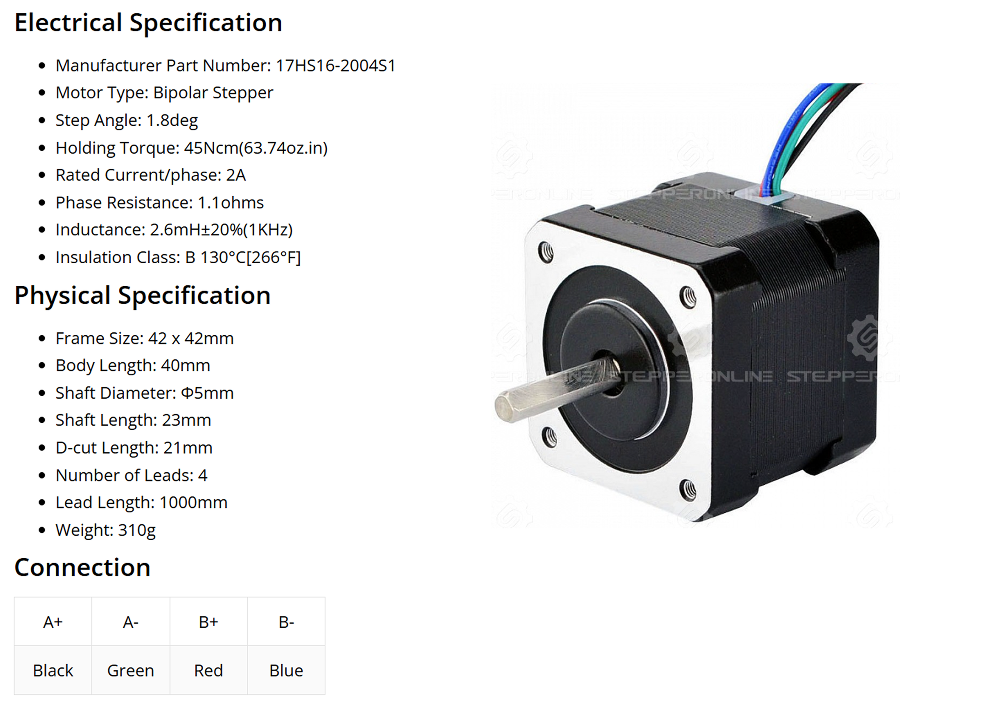

# Motor parameters and calibration

Calibration teaches the driver its motor: it checks the magnet and the supply, takes the motor's resistance,
inductance and pole pairs from you, computes the current loop gains, spins the motor in open loop to learn the
direction of the wiring, finds the angle offset between the encoder and the motor's electrical zero, and measures
the motor constants Kt, KV and the flux linkage. It runs once per motor; the result is kept by saving.

!!! danger "The motor turns"
    Calibration spins the motor in both directions, fast at times. Fix the motor to the bench and take everything
    off the shaft.

!!! tip "Supply voltage"
    Calibrate at 24 V. At a lower voltage the KV and Kt come out wrong.

## 1. Enter the motor parameters

STEPFOC does not measure the resistance and inductance of a stepper (the Spectral Micro does for a BLDC); you
enter them from the motor's datasheet, as the values of **one coil**, and the pole pairs. Calibration fails on a
value left at 0, and accepts only 50, 75, 100 or 125 pole pairs.

=== "Motor GUI"
    In the motor settings enter *Pole pairs* (50 for a 1.8° motor, 75 for 1.2°, 100 for 0.9°, 125 for 0.72°),
    *Resistance* in ohms and *Inductance* in henries, and apply them.

=== "Terminal"
    ```
    #PP 50          1.8° stepper: 50; 1.2°: 75; 0.9°: 100; 0.72°: 125
    #R 1.1          phase resistance in ohms
    #L 0.0026       phase inductance in henries (2.6 mH)
    ```

<figure markdown="span">
  { width="900" }
  <figcaption>Figure 17: The three values on a typical datasheet, here for the 17HS16-2004S1: 1.8°, 1.1 Ω, 2.6 mH.</figcaption>
</figure>

The current loop bandwidth (`#Cbw`, 500 Hz by default) decides the gains calibration computes from R and L;
leave it for now, [Current limit and loop tuning](tuning.md) comes back to it.

## 2. Run it

=== "Motor GUI"
    Start the calibration. The driver enters *Calibration mode* and the GUI shows its log step by step; when it
    finishes, the phase order and direction, Kt, KV and the flux linkage it found appear in the settings.

=== "Terminal"
    ```
    #Cal
    ```

The LED flashes every 0.5 s while the routine runs, and the driver prints each step as it goes:

```
----------------
Calibration mode
----------------
Pole pair test: Passed
Magnet test: Passed
Vbus test: Passed
Resistance = 1.100000Ohm
Inductance = 0.002600H
Kp_iq = ...
Ki_iq = ...
Open loop direction: good
Angle offset is: ...
Phase order is good!
KV is: ...
Kt is: ...
Flux linkage is: ...
----------------
Calibration success!
Save config with #Save
Going to idle!
----------------
```

What the steps are:

| Step | What happens | Fails with |
|---|---|---|
| Pole pair test | the entered pole pairs are one of 50, 75, 100, 125 | `Pole pair test: Failed` and the list of values |
| Magnet test | the encoder sees enough field | `Magnet test: Failed`: magnet missing, too far, or axially magnetised |
| Vbus test | the supply is within limits | `Vbus test: Failed` |
| Resistance, inductance | the entered values are not 0; they are printed back and Kp_iq, Ki_iq computed from them and the bandwidth | `Resistance test: Failed` / `Inductance test: Failed`, with `Please enter your stepper resistance by using #R command` |
| Open loop | the motor is stepped open loop; the encoder must see it turn. The direction it turned is remembered, so a reversed coil is compensated from here on | `Open loop: Failed` / `Switch motor phases and try again!`: the encoder saw no rotation |
| Angle offset | the motor is driven to find the offset between encoder zero and electrical zero. It spins quickly one way, then the other, for up to two minutes | `Phase order is wrong!` / `Switch motor phases and try again!`: the commutation check got no response from the motor on two tries. A line `Spin-confirm delta: … ticks (need > 8192), Vbus: … mV` says how far the motor turned and at what voltage |
| Kt, KV, flux linkage | the motor spins fast for a moment and the constants are computed from the back-EMF | — |

!!! note "The two 'Switch motor phases' messages"
    They are left over from firmware 103, which needed the coils wired a particular way. Since firmware 105 the
    wiring is detected and compensated, so these messages mean the motor did not turn or did not respond: a coil
    not connected or shorted, a current limit at 0, a supply too weak, or a magnet that slips. Swapping wires does
    not fix them.

## 3. Save

=== "Motor GUI"
    **Save**. The GUI marks *Unsaved changes* until you do.

=== "Terminal"
    ```
    #Save
    ```

Without it the calibration is gone at the next power cycle. The driver goes to idle and the LED shows normal
operation; the state shows *Calibrated* and the constants.

## When to calibrate again

- After changing the motor, the magnet or the wiring.
- After restoring the defaults.
- After a firmware update that clears the calibration (a release note says so when it does).

A calibration that reports success but a motor that runs badly afterwards usually means the magnet moved on the
shaft between calibration and use: fix the magnet and calibrate again.

## Troubleshooting

| Message | Cause |
|---|---|
| `Magnet test: Failed` | no magnet, magnet too far (more than about 1.5 mm), or an axially magnetised magnet |
| `Vbus test: Failed` | supply off, too low, or the cable the wrong way round (if the driver survived it) |
| `Resistance test: Failed`, `Inductance test: Failed` | the resistance or the inductance still 0 |
| `Open loop: Failed` | the motor did not turn: a coil open, the open-loop voltage (`#Openv`) too low for the motor, no supply current |
| `Phase order is wrong!` | see the note above: the motor did not respond to the commutation check; check the wiring, the current limit and the magnet |
| the routine stops in a step and prints nothing more | reset the driver (`#Reset`) and try again |
| success, but the LED stays on and no error is reported | the state shows `-1` somewhere: the EEPROM is not in the firmware's layout; restore the defaults, enter the parameters, calibrate again |

The angle-offset step alone can be repeated with `#Calangle`.
