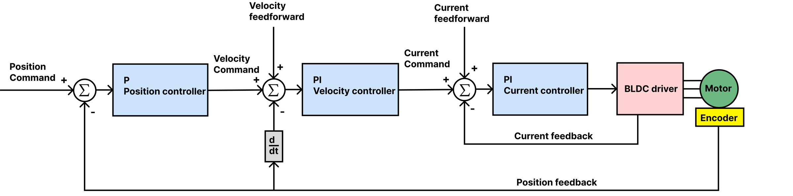
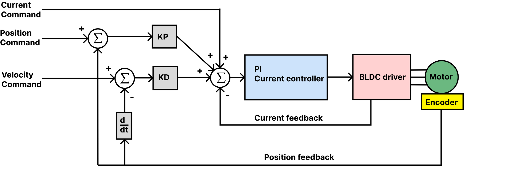

# Current limit and loop tuning

Calibration leaves the driver with current loop gains computed for your motor and with conservative velocity and
position gains. Two things remain: the current limit, which you must set for your motor, and the loop gains, which
you tune if the defaults do not suit it.

## The current limit

```
#Ilim 1500
#Save
```

Set `#Ilim` to the rated phase current of your motor in mA (the datasheet value; the tested motors' ratings are
in [Tested motors](../03-technical-data/tested-motors.md)). The firmware clamps the limit to the driver's 2800 mA
and does not trip on phase current by itself; the MOSFET driver's hardware protection only catches a hard fault.
A limit above the motor's rating overheats the motor.

Crunching and whining sounds at speed usually mean the current limit, or the current loop gains, are too high.

## The loops

<figure markdown="span">
  { width="800" }
  <figcaption>Figure 13: The position loop commands the velocity loop, which commands the current loop.</figcaption>
</figure>

Tune from the inside out: the current loop first, then velocity, then position. Before you start:

- The motor must be calibrated and without active errors; the driver refuses the control modes otherwise.
- Fix the motor to the bench, nothing on the shaft. A loop that oscillates can shake a loose motor off the table.
- If the defaults oscillate, lower all gains until the motor is quiet, then raise them one at a time in small steps.

### The current loop

The current loop is a PI controller that turns a current request into a voltage. Calibration sets its gains
`Kpiq` and `Kiiq` from the motor's resistance and inductance and the bandwidth `#Cbw` (500 Hz by default; set it
before `#Cal`). For a stepper these computed gains are a starting point; tune by hand if the motor hums or responds
slowly:

1. Raise `#Kpiq` until the motor starts to hum or oscillate, then back off 20 %.
2. Raise `#Kiiq` the same way, then back off a little.
3. Test with `#Iq 300`: the motor should push with a steady, quiet torque. Keep the current well under the limit.

A higher bandwidth responds faster to a disturbance and is louder; 800 Hz and more is common in industry, and
useful for legged robots.

### The velocity loop

1. Raise `#Kpv` until the motor oscillates at a steady speed command, then back off 20 %.
2. Raise `#Kiv` slowly until it oscillates, then back off a little. `Kiv` is an integrator: too much makes the
   motor unstable, none leaves a steady-state error.
3. Test with `#V 20000` (encoder ticks per second; 16384 is one revolution per second) and with different speeds.

### The position loop

1. Raise `#Kpp` until the motor overshoots or oscillates when it reaches a target, then back off.
2. Test with `#P 16384` and `#P 0`: one revolution and back. The response should be quick, without overshoot.

### Testing

Run the motor over the whole range of speeds and loads it will see, with a load if you can, and adjust. Then
`#Save`.

## Impedance (PD) mode

<figure markdown="span">
  { width="800" }
  <figcaption>Figure 14: The impedance loop: a spring (KP) and a damper (KD) around the position setpoint, plus a current feedforward.</figcaption>
</figure>

In PD mode the motor behaves like a spring and a damper: the torque is `KP × (setpoint − position) + KD × (speed
setpoint − speed) + feedforward current`. Set `#KP` and `#KD` (or Send_PD_Gains), then command with `#PD`, `#PDV`
and `#PDI` or Send_data_pack_PD. Start with a small `KP` and `KD` of 0, raise `KP` until the motor holds position
firmly, then add `KD` until it stops ringing.

## Limits

- `#Vlimit` clamps the speed the loops may command (encoder ticks per second). A rough maximum for your motor is
  0.8 × Vbus × KV × 16384 / 60 ticks per second, with KV from calibration.
- `#Vlim` clamps the voltage of the current loops in mV; 0 uses the supply voltage.
- `#Rstint 1` resets the integrators on every new setpoint, which avoids windup when a program sends one setpoint
  after another with large steps.
