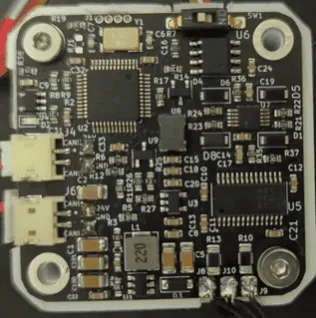
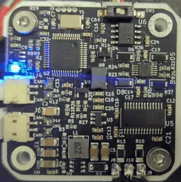
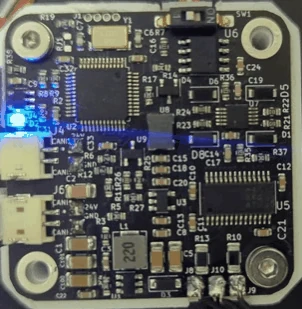

# Errors and recovery

When the driver detects a fault it stops the motor, goes to idle, turns the status LED on steadily and sets the
error bit in every CAN frame it sends. It stays there until the error is cleared.

## Seeing the error

- **The LED**: on and not flashing means error mode (or not calibrated). Three short flashes and a pause is
  normal operation; fast flashing is calibration.
- **`#Error`** prints `In error state!` or `No errors!`, followed by one line per active error.
- **Send_Respond_State_of_Errors** returns every flag as a bit; **the error bit** of any frame says whether there
  is one.

| Normal operation | Calibration | Error mode |
|---|---|---|
| { width="180" } | { width="180" } | { width="180" } |

In error mode the LED does not flash: it stays on, as in the photo on the right.

## The errors

| Error | `#Error` line | Cause | What to do |
|---|---|---|---|
| Vbus | `Vbus error` | the supply voltage is below 9 V or above 29 V (`#Vmax`, 29000 mV after `#Default`). From firmware 109 a low voltage is not checked for the first 500 ms after power-up, while the supply ramps up | check the supply and the cable; a decelerating motor can push the voltage up |
| Encoder | `Encoder error` | the encoder reports no magnet: missing, too far away or too weak | magnet distance and type, see [The encoder magnet](../04-mounting/magnet.md) |
| Driver | `Driver error (undervoltage, thermal shutdown, or overcurrent)` | reserved: this firmware never raises it, because it does not monitor the driver stage | — |
| Velocity | `Velocity error` | the speed passed 30,000,000 ticks/s, a fixed threshold that `#Vlimit` does not change; in practice only a runaway reaches it | check the magnet and the calibration |
| Temperature | `Temp error` | the thermistor reads more than `#Tlim` (75 °C by default) or less than −20 °C, with `#Term 1`. A thermistor that is not plugged in reads far below −20 °C | let the motor cool; lower the current limit |
| E-stop | `Received ESTOP command` | Send_ESTOP was received | clear it when it is safe |
| Watchdog | `Watchdog error` | no motion frame or answered request within the watchdog time (Send_Watchdog); what the motor does then is the watchdog's action, see [The watchdog](watchdog.md) | the host stopped sending; fix the host, then clear |
| Wrong product | `Wrong firmware for this board (product lock)` | from firmware 109: this board was calibrated by the other product (a Spectral Micro firmware on a STEPFOC, or the other way round), so the firmware drives nothing ([The product lock](diagnostics.md#the-product-lock)) | flash the right firmware; it does not clear otherwise |
| Not calibrated | `Not calibrated` | the motor has not been calibrated since `#Default`, or the EEPROM is invalid | run `#Cal` and `#Save` |
| Current | `Current error` | reserved; this firmware never raises it | — |

## Clearing

`#Clear` or Send_Clear_Error clears the flags and goes to idle. An error whose cause is still present comes
straight back: a Vbus error at 2 V stays until the supply is right; once the supply is 24 V, one `#Clear` returns
the driver to normal operation. The calibration error clears only by calibrating (or, for a motor you know is
calibrated, `#Calibrated 1`). A gripper E-stop comes back on every control cycle until its E-stop bit is 0 again:
`#Gripstop 0`, or a Send_gripper_data_pack with the bit clear; then clear. While it is active, `#Error` prints only
`In error state!`.

## When the driver does not answer

- No LED at all: no power. Check DC+ and DC− and the cable orientation.
- LED on, no answer on UART: the baud rate (256000), TX and RX crossed, the adapter's port.
- No answer on CAN: the node ID, the termination (about 60 Ω across the bus, unpowered), 1 Mbit/s on the adapter.
- `#Info` shows `-1` or nonsense: with firmware 106 and newer this should not happen, because the driver replaces a
  damaged configuration block with the defaults at power-up. If it does, `#Default`, then calibrate again.

[Troubleshooting](../08-troubleshooting/index.md) goes through the symptoms one by one.
