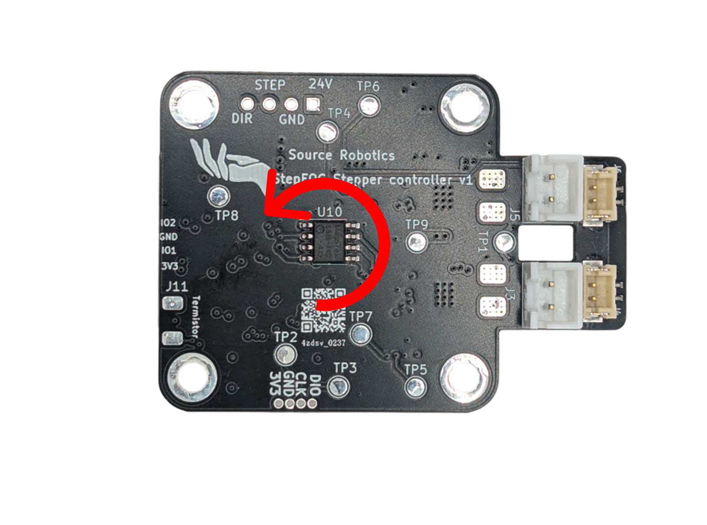

# Control modes

The driver is always in one control mode. A command that carries a setpoint switches to the mode that uses it;
`#Idle` or Send_Idle switches back to idle. The driver refuses the closed-loop modes while it is not calibrated or
while an error is active.

| Mode | What the motor does | Entered by | Setpoint unit |
|---|---|---|---|
| Idle | nothing: coasts (phases open) or brakes (phases shorted), as set by `#Brake` / `#Coast` or Send_Settings | `#Idle`, Send_Idle, `#Clear`, errors | — |
| Position | holds and moves to a position with the cascade of position, velocity and current loops | `#P`, Send_data_pack_1 (8 bytes) | encoder ticks |
| Velocity | turns at a speed with the velocity and current loops | `#V`, Send_data_pack_1 (5 bytes) | encoder ticks/s |
| Current (torque) | applies a current, so a torque, with the current loop alone | `#Iq`, Send_data_pack_1 (2 bytes) | mA |
| PD (impedance) | behaves like a spring and a damper around a position, with `KP` and `KD` | `#PD`, Send_data_pack_PD | encoder ticks |
| Voltage torque | applies a voltage on the q axis directly, without the current loop | `#Uq` | mV |
| Open loop | steps the motor like a plain stepper driver, without the encoder | `#Openloop` (continuous), `#gosteps` (a number of steps) | electrical speed; steps |
| HALL | spins until a sensor on ADDITIONAL2 triggers, then holds the position reached | `#HALL`, Send_data_pack_HALL | encoder ticks/s |
| Gripper | runs the gripper state machine: move to a jaw position with a speed and a current limit | `#Grippos`, Send_gripper_data_pack (with `#Gripper 1`) | 0 to 255 |
| Calibration | the calibration routine, and the angle-offset step alone | `#Cal`, `#Calangle`, `#Gripcal` | — |

## Units

- **Position** is in encoder ticks: 16384 per revolution of the motor shaft, counting up without limit over
  several revolutions. Positive is counter-clockwise seen from the magnet (the back of the motor).
- **Speed** is in encoder ticks per second: 16384 is one revolution per second, 60 rpm.
- **Current** is in mA. Torque is current times the motor's Kt, which calibration finds.
- **Feedforward**: the 8-byte motion frame carries a speed and a current feedforward beside the position, the
  5-byte one a current feedforward beside the speed. They are added after the loops, so a host that knows the
  trajectory can command it directly and leave the loops to correct the rest. Send 0 when you do not use them.

## Positive rotation

<figure markdown="span">
  { width="700" }
  <figcaption>Figure 15: Positive rotation is counter-clockwise looking at the encoder magnet. A positive current turns the motor that way, a positive speed too, and the position grows.</figcaption>
</figure>

## Which mode am I in?

`#Mode` prints the mode. Its text for the voltage-torque mode reads `Gripper mode` in this firmware release (a
leftover label); `#Info` and the behaviour of the motor are the reliable check.
