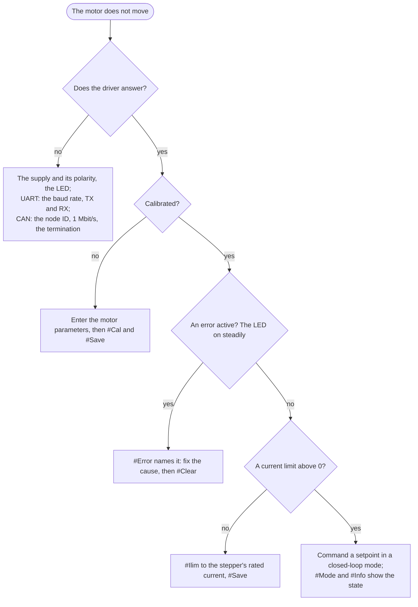

# Troubleshooting

By symptom. The error flags and what clears them are in [Errors and recovery](../06-operation/errors.md); the
faults of the firmware that are known and not yet fixed, with what to do until they are, in
[Known issues](known-issues.md).

## The motor does not move

## The driver does not answer

| Symptom | Check |
|---|---|
| No LED | the supply, DC+ and DC−, the power cable's orientation. If the cable was the wrong way round the driver is destroyed |
| LED on, nothing on the terminal | 256000 baud; TX to RX and RX to TX; the adapter's port; 3.3 V adapter; the line ending CR+LF |
| LED on, nothing on CAN | the node ID; 1 Mbit/s on the adapter; termination (about 60 Ω across CAN H and CAN L with everything unpowered); the CAN cable's orientation |
| `Unknown command` | the name's spelling and case: `#Kpiq`, not `#kpiq`; an argument with a space in it (`#WdFb 2000,0,1000,2`, not `#WdFb 2000, 0, 1000, 2`) |
| `Wrong firmware for this board (product lock)`, the LED on steadily | the other product's firmware was flashed: a Spectral Micro image on a STEPFOC. Flash the STEPFOC firmware; the configuration was not touched ([The product lock](../06-operation/diagnostics.md#the-product-lock)) |
| the LED keeps blinking and nothing answers after a firmware update | the bootloader has no valid firmware, or its CRC does not match after an upload with the programming adapter: flash again through the bootloader, see [Updating through the bootloader](../07-firmware/update.md) |

## Motor GUI

| Symptom | Check |
|---|---|
| the browser offers no port | a Chromium-based browser (Chrome, Edge, Brave, Opera); Firefox and Safari have no Web Serial |
| the port is listed but will not open | another program holds it: a terminal, PlatformIO's monitor, the Arduino serial monitor |
| the port opens, nothing appears | the driver's power; TX and RX crossed on a non-Source adapter; the baud rate on a non-Source adapter (256000) |
| *No connection* on CAN | the CANvas adapter's port; the bus termination; the node ID of the driver; 1 Mbit/s |
| the calibration does not start | calibration runs over the serial connection only, not over CAN |
| *Unsaved changes* after a power cycle | the settings were not saved to the driver; Save writes them |
| the firmware update finds no bootloader | power-cycle the driver while the GUI scans, to catch the bootloader's 2 s window. A driver with firmware 103 or older from the `main` branch has no bootloader: [Installing the bootloader on an older board](../07-firmware/bootloader.md) |

## Calibration

The messages and their causes are in [Motor parameters and calibration](../05-setup/calibration.md). The ones that
come back most:

| Symptom | Cause |
|---|---|
| `Magnet test: Failed` | magnet too far, axially magnetised, or missing |
| the motor wobbles left and right during calibration | one coil is not connected |
| the motor does not move in the open-loop step | a coil open or not soldered; calibration then fails at the next step with `Phase order is wrong!` |
| `Phase order is wrong!` | the motor did not respond to the commutation check; wiring, current limit, magnet |
| calibration succeeds, the motor then runs badly or in the wrong direction | the magnet slipped on the shaft; glue it and calibrate again |
| after `Calibration success!` the motor turns slowly by itself for about a minute | the encoder table and the anti-cogging that follow a calibration (parameter 56); let them finish, they save everything ([What follows the calibration](../05-setup/calibration.md#what-follows-the-calibration)) |
| the runs after the calibration stopped: `#Info` shows the encoder table or the anti-cogging not on | a command came in, the shaft was blocked or an error came up; the state is in parameters 52 and 43 ([When a run fails](../05-setup/anti-cogging.md#checking-them)). `#Save` keeps the calibration; `#Encal all` runs both again |
| the anti-cogging does not switch on (parameter 37 stays 0) | no set is identified for that form; run `#Cogcal save`, or calibrate. After an encoder table measured on its own the set is switched off until it is identified again |
| calibration succeeds but the LED stays on and `#Error` shows nothing | should not happen with firmware 106 and newer, which replaces a damaged configuration block with the defaults at power-up; if `#Info` shows `-1`: `#Default`, parameters, calibrate again |

## The motor

| Symptom | Cause |
|---|---|
| crunching or whining at speed | the current limit or the current loop gains too high; lower `#Ilim`, lower `#Cbw` and calibrate again, or lower `#Kpiq` |
| humming, oscillating at rest | `#Kpv` or `#Kpp` too high; see [Current limit and loop tuning](../05-setup/tuning.md) |
| weak torque | `#Ilim` low; the supply's current limit; the wrong `#R`/`#L` (the computed current gains are off) |
| the motor is hot | normal for a stepper at its rated current; lower `#Ilim`, enable the thermistor |
| it stops with a Vbus error when decelerating | the supply cannot absorb the returned energy; a different supply, or a brake resistor |
| it stops with a velocity error | the speed passed 30,000,000 ticks/s, a fixed threshold that `#Vlimit` does not change: a runaway, so check the magnet and the calibration |
| it loses position with a load | that is a torque limit: a stepper under FOC does not lose steps, it falls behind; raise `#Ilim` within the motor's rating, or more motor |
| it holds position with a sawtooth noise | the position loop gain; the magnet distance |

## Low-quality motors

Motors with visibly bad windings, an uneven back-EMF or a resistance that differs between the two coils calibrate
poorly and run rough. The [tested motors](../03-technical-data/tested-motors.md) are known good.

## The magnet and the encoder

- The distance is 1 mm. "Magnet Good" from the magnet test does not mean the distance is right, only that the
  field is strong enough.
- A magnet touching the chip can destroy the microcontroller; a magnet too far gives a noisy, wrong position.
- The magnet must be diametrically magnetised and centred on the shaft.

## The driver gets hot or shuts down

The firmware does not monitor the driver stage: if the stage stops on its own, for heat or a short, the motor
loses torque and no error is reported. Lower the current limit, give the board airflow, check the motor leads for
a short. Near 2.8 A the driver needs cooling.

## After a firmware update

`#Info` shows the new release. If the values look wrong or the LED stays on: `#Default`, enter the motor
parameters, `#Cal`, `#Save`. A release note says when an update clears the calibration. After an update to 109,
[Upgrading from older firmware](../07-firmware/upgrading.md) says what to run: a calibration, then the velocity
gains.

A Vbus error right after power-up, cleared by `#Clear`, was the supply ramping up; from firmware 109 a low supply is
not checked in the first 500 ms.

## Getting help

[Support](../support/index.md) says where to ask and what to include; `#Info`'s output is the first thing.
