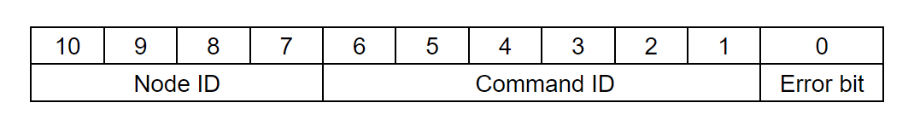

# CAN interface

**CAN bus** should be your primary choice when developing robotic application.  
STEPFOC uses 5V CAN bus that adheres to the CAN 2.0 standard. Each STEPFOC driver has 2 CAN bus connectors allowing you to easily daisy chain multiple devices. 

    

Bits **10 - 7** of CAN ID represent Node ID.  
Node IDs can range from 0 - 15 Meaning you can have maximum 16 different devices on one CAN bus. 

Bits **6 - 1** of the CAN ID represent Command ID. 
Command IDs can range from 0 - 63.

Bit **0** represents error bit. If STEPFOC controller has any active error this bit will be set to 1. Note this bit is send always by the driver and is independent about the command ID and data.

Node with smallest Node ID is strongest in CAN bus arbitration.

**If you want to learn more about CAN bus we recommend you read this [article!](https://www.csselectronics.com/pages/can-bus-simple-intro-tutorial)**

**This page describes can protocol** 
**You can use our [Python CAN bus API](https://github.com/Source-Robotics/Spectral-BLDC-Python/tree/main) to communicate with your STEPFOC controllers!**  
**If you want to see more examples on how to write Python scripts to control your motor over CAN [check this guide!](Guides/Python_guide.md)**

## List of commands

!!! note "Message names"
    **Send_...** are messages the host sends to the STEPFOC controller. To some of them the driver answers with a message prefixed with Respond. 
    **Respond_...** are messages the STEPFOC controller sends to the host. 
    **Send_Respond_...** are data the host requests from the controller with a remote frame (RTR bit set). The controller answers with a data frame with the same command ID.

 Command ID | Name | Type | Data 
---- | ---- | ---- | ---- 
9 | `Respond_Heartbeat` | Respond | None 
3 | `Respond_data_pack_1` | Respond | Position [Encoder ticks]   Velocity [Encoder ticks/s]   Current [mA]
5 | `Respond_data_pack_2` | Respond | Reserved, not used 
7 | `Respond_data_pack_3`| Respond | Reserved, not used 
60 | `Respond_Gripper_data_pack` | Respond | Position    Current   Gripper activation status   Gripper action status   Object detection status    Temperature error   Timeout error   Estop error   Calibration status
32 | `Respond_data_hall` | Respond | Position    HALL trigger    additional_pin2

 Command ID | Name | Type | Data 
---- | ---- | ---- | ----
2 | `Send_data_pack_1` | Send | Position [Encoder ticks]   Velocity [Encoder ticks/s]   Current [mA]
6 | `Send_data_pack_2` | Send | Reserved, not used
8 | `Send_data_pack_3` | Send | Reserved, not used
4 | `Send_data_pack_PD` | Send  |Position [Encoder ticks]   Velocity [Encoder ticks/s]   Current [mA]
61 | `Send_gripper_data_pack` | Send | Position    Velocity    Current [mA]    Gripper activation    Gripper action   Estop status   Release direction
62 | `Send_gripper_calibrate` | Send | None
16 | `Send_PD_Gains` | Send | KP   KD
17 | `Send_Current_Gains` | Send | Kpiq   Kiiq 
18  | `Send_Velocity_Gains` | Send |Kpv   Kiv 
19 | `Send_Position_Gains` | Send | Kpp
20 | `Send_Limits` | Send | Velocity limit   Current limit
22 | `Send_Kt` | Send | Kt 
11 | `Send_CAN_ID` | Send | CAN ID
0 | `Send_ESTOP` | Send | None
12 | `Send_Idle` | Send | None
13 | `Send_Save_config` | Send | None
14 | `Send_Reset` | Send | None
1 | `Send_Clear_Error` | Send | None
15 | `Send_Watchdog` | Send | Time   Action
30 | `Send_Heartbeat_Setup` | Send | Time
29 | `Send_Cyclic_command` | Send | Reserved, not implemented
31 | `Send_data_pack_HALL` | Send | Speed    trigger_value

 Command ID | Name | Type | Respond data 
---- | ---- | ----  | ---- 
23 |`Send_Respond_Temperature` | Send/Respond | Temperature
24 |`Send_Respond_Voltage` | Send/Respond | Vbus voltage
25 |`Send_Respond_Device_Info` | Send/Respond | Serial number   Hardware version   Batch date   software version
26 |`Send_Respond_State_of_Errors` | Send/Respond | Error   Temperature error   Encoder error   Vbus error   Driver error   Velocity error   Current error   ESTOP error   Calibration status   Activated status   Watchdog error 
27 |`Send_Respond_Iq_data` | Send/Respond | Iq current
28 |`Send_Respond_Encoder_data` | Send/Respond | Position [Encoder ticks]   Velocity [Encoder ticks/s]
10 |`Send_Respond_Ping` | Send/Respond | None

## Watchdog

**By default watchdog is turned off.** 
Each valid CAN message received by the STEPFOC controller resets its watchdog timer. 
Watchdog measures time between the commands that STEPFOC receives. 
If it is bigger than time you set it will report Watchdog error and go to error mode.
To clear the error you will need to call:

    "Send_Clear_Error"

## Heartbeat
**By default the heartbeat is off (rate 0).** Send_Heartbeat_Setup turns it on; a rate of 0 turns it off again. Send_Save_config keeps the setting. 
Heartbeat is function that will Send "Respond_Heartbeat" msg every time interval you set in "Send_Heartbeat_Setup".  
This is useful when your host device needs to see if STEPFOC is connected/alive.  
In case your STEPFOC sends any other data (as a response to command) it will reset its heartbeat timer.

!!! tip "Heartbeat timer reset"
    For example if STEPFOC is sending data every 10ms and heartbeat is setup to send every 1s; heartbeat will never send its data. 

## Cyclic

!!! info "Not implemented"
    Command ID 29 (Send_Cyclic_command) is reserved. The firmware has no handler for it, and the Python library's Send_Cyclic_command() does nothing.

## Commands

!!! note "Bit numbering"
    In the tables below, bit numbers count from the most significant bit of the byte: bit 7 is the first flag the firmware packs into the byte, bit 0 the last.

### Respond_Heartbeat

This is the command that driver will send as its heartbeat every X ms. It is an empty data frame. 

* Command ID: 9  
* Direction: driver -> host  
* Python call: None, this command is sent only by driver  
* Length: 0 byte 
* Type of frame: standard 

---

### Respond_data_pack_1

This is the command that driver will send as a response to movement commands like Send_data_pack_1 and Send_data_pack_PD.  

* Command ID: 3  
* Direction: driver -> host  
* Python call: None, this command is sent only by driver  
* Length: 8 byte 
* Type of frame: standard  

Size (bytes) | Variable (Spectral_BLDC Lib python attribute)  | Type | Details
---- | ---- | ---- | ---- 
0 - 2 | position | signed 24bit | unit is encoder ticks
3 - 5 | speed | signed 24bit | unit is encoder ticks/s
6 - 7 | current | signed 16bit  | unit is mA

---

### Respond_Gripper_data_pack

This is the command that driver will send as a response to Send_gripper_data_pack.  

* Command ID: 60  
* Direction: driver -> host  
* Python call: None, this command is sent only by driver  
* Length: 4 byte  
* Type of frame: standard  

Size (bytes) | Variable (Spectral_BLDC Lib python attribute)  | Type | Details
---- | ---- | ---- | ----
0  | gripper_position | unsigned 8bit | 255 fully closed, 0 fully open
1-2 | gripper_current |  16 bit signed | measured current, unit mA
3 (bit 7) | gripper_activated | bit (0/1) | gripper activate (1) / deactivated (0)
3 (bit 6) | gripper_action_status | bit (0/1) |  1 is goto, 0 is idle or performing auto release or in calibration
3 (bits 5 and 4) | gripper_object_detection | 2 bits; bit 5 is the low bit, bit 4 the high bit | 0 in motion, 1 object detected closing, 2 object detected opening, 3 at position
3 (bit 3) | gripper_temperature_error | bit (0/1) | gripper_temperature_error
3 (bit 2) | gripper_timeout_error | bit (0/1) | gripper_timeout_error
3 (bit 1) | gripper_estop_error | bit (0/1) | gripper_estop_error
3 (bit 0) | gripper_calibrated | bit (0/1) | gripper calibration status; calibrated (1) / not calibrated (0)

---

### Respond_data_hall

This is the command that driver will send as a response to Send_data_pack_HALL. It will return motor position in encoder ticks and state of the hall pin.  

* Command ID: 32  
* Direction: driver -> host  
* Python call: None, this command is sent only by driver  
* Length: 4 byte  
* Type of frame: standard  

Size (bytes) | Variable (Spectral_BLDC Lib python attribute)  | Type | Details
---- | ---- | ---- | ----
0 - 2 | position | signed 24bit | unit is encoder ticks
3 (bit 7) | HALL_trigger | bit (0/1) | 1 while waiting for the trigger, 0 once it has triggered
3 (bit 6) | additional_pin2 | bit (0/1) | RAW pin state

---

### Send_data_pack_1

This command will place the driver in position, speed or current control mode depending on the amount of parameters you give it. 
Note that if you don't want feedforward just set it to 0. 

* Command ID: 2  
* Direction: Host -> driver  
* Python call: Send_data_pack_1()  
* Type of frame: standard  
* Length: 8 byte -  If using position setpoint with speed and current feedforward

Size (bytes) | Variable | Type | Details
---- | ---- | ---- | ----
0 - 2 | Position setpoint | signed 24bit | unit is encoder ticks
3 - 5 | Velocity feedforward  | signed 24bit | unit is encoder ticks/s
6 - 7 | Current feedforward | signed 16bit | unit is mA

* Length: 5 byte -  If using speed setpoint and current feedforward

Size (bytes) | Variable | Type | Details
---- | ---- | ---- | ----
0 - 2 | Velocity setpoint | signed 24bit | unit is encoder ticks/s
3 - 4 | Current feedforward | signed 16bit | unit is mA

* Length: 2 byte -  If using current setpoint

Size (bytes) | Variable | Type | Details
---- | ---- | ---- | ----
0 - 1 | Current setpoint| signed 16bit | unit is mA

Driver will respond to this command with: 
**Respond_data_pack_1**

---

### Send_data_pack_PD

This command will place the driver in impedance PD control mode. 

* Command ID: 4  
* Direction: Host -> driver  
* Python call: Send_data_pack_PD()  
* Type of frame: standard  
* Length: 8 byte 

Size (bytes) | Variable | Type | Details
---- | ---- | ---- | ----
0 - 2 | Position | signed 24bit | unit is encoder ticks
3 - 5 | Velocity | signed 24bit | unit is encoder ticks/s
6 - 7 | Current | signed 16bit  | unit is mA

Driver will respond to this command with: 
**Respond_data_pack_1**

---

### Send_data_pack_HALL

This command will try spin the motor at set speed until the hall sensor attached to additional_pin2 on the driver triggers. 

* Command ID: 31  
* Direction: Host -> driver  
* Python call: Send_data_pack_HALL()  
* Type of frame: standard  
* Length: 4 byte 

Size (bytes) | Variable | Type | Details
---- | ---- | ---- | ----
0 - 2 | speed | signed 24bit | unit is encoder ticks/s
3 (bit 7) | trigger_value | bit (0/1) | the sensor level that triggers: 0 or 1

Driver will respond to this command with: 
**Respond_data_hall**

---

### Send_gripper_data_pack

This command will command the motor (SSG48 gripper) to move to specific position with speed/torque.

* Command ID: 61  
* Direction: Host -> driver  
* Python API reference: Send_gripper_data_pack()  
* Type of frame: standard  
* Length: 5 byte 

Size (bytes) | Variable | Type | Details
---- | ---- | ---- | ----
0  | Position | unsigned 8bit | 0 fully open, 255 fully closed
1 | Velocity | unsigned 8bit | 0 min speed, 255 max speed
2-3 | Current | signed 16bit | current limit for the move, unit mA; the firmware does not clamp it, see the gripper manual for the safe range
4 (bit 7) | Gripper activate | bit (0/1) | 0 deactivate the gripper, 1 activate the gripper
4 (bit 6) | Gripper action status | bit (0/1) | 1 go to the position, 0 idle
4 (bit 5) | Gripper estop status | bit (0/1) | 1 raises the gripper E-stop error
4 (bit 4) | Gripper release direction | bit (0/1) | read by the firmware but not used

Driver will respond to this command with: 
**Respond_Gripper_data_pack**

Alternatively you can send empty Send_gripper_data_pack command.

* Command ID: 61  
* Direction: Host -> driver  
* Python API reference: Send_gripper_data_pack()  
* Type of frame: standard  
* Length: 0 byte 

Driver will respond to this command with: 
**Respond_Gripper_data_pack**

---

### Send_gripper_calibrate

This command will start gripper calibration. It is an empty data frame.

* Command ID: 62  
* Direction: Host -> driver  
* Python API reference: Send_gripper_calibrate()  
* Type of frame: standard  
* Length: 0 byte 

**Driver will not respond to this command!** 

---

### Send_PD_Gains

This command will set KP and KD gains for the PD impedance loop.

* Command ID: 16  
* Direction: Host -> driver  
* Python API reference: Send_PD_Gains()  
* Type of frame: standard  
* Length: 8 byte 

Size (bytes) | Variable | Type 
---- | ---- | ----
0 - 3 | KP | float 32
4 - 7 | KD | float 32 

**Driver will not respond to this command!** 

---

### Send_Current_Gains

This command will set Ki and Kp PI parameters for the PI current control loop.

* Command ID: 17  
* Direction: Host -> driver  
* Python API reference: Send_Current_Gains()  
* Type of frame: standard  
* Length: 8 byte 

Size (bytes) | Variable | Type 
---- | ---- | ----
0 - 3 | Kp_iq | float 32
4 - 7 | Ki_iq | float 32 

**Driver will not respond to this command!** 

---

### Send_Velocity_Gains

This command will set Ki and Kp PI parameters for the PI speed/velocity control loop.

* Command ID: 18  
* Direction: Host -> driver  
* Python API reference: Send_Velocity_Gains()  
* Type of frame: standard  
* Length: 8 byte 

Size (bytes) | Variable | Type 
---- | ---- | ----
0 - 3 | Kpv | float 32
4 - 7 | Kiv | float 32 

**Driver will not respond to this command!** 

---

### Send_Position_Gains

This command will set Kp P parameter for the P position control loop.

* Command ID: 19  
* Direction: Host -> driver  
* Python API reference: Send_Position_Gains()  
* Type of frame: standard  
* Length: 4 byte 

Size (bytes) | Variable | Type 
---- | ---- | ----
0 - 3 | Kpp | float 32

**Driver will not respond to this command!** 

---

### Send_Limits

This command will set velocity/speed and current limits. 
This will limit max speed and current that can be reached during motor operation.

* Command ID: 20  
* Direction: Host -> driver  
* Python API reference: Send_Limits()  
* Type of frame: standard  
* Length: 8 byte 

Size (bytes) | Variable | Type | Details
---- | ---- | ---- | ----
0 - 3 | Velocity limit | float 32 | unit is encoder ticks/s
4 - 7 | Current limit | float 32 | unit is mA

**Driver will not respond to this command!** 

---

### Send_Kt

This command will set Kt of the motor driver.

* Command ID: 22  
* Direction: Host -> driver  
* Python API reference: Send_Kt()  
* Type of frame: standard  
* Length: 4 byte 

Size (bytes) | Variable | Type 
---- | ---- | ----
0 - 3 | Kt | float 32

**Driver will not respond to this command!** 

---

### Send_CAN_ID

This command will set a new CAN ID for your motor driver.  
Note that ID you send is the new motor ID.

* Command ID: 11  
* Direction: Host -> driver  
* Python API reference: Send_CAN_ID()  
* Type of frame: standard  
* Length: 1 byte 

Size (bytes) | Variable | Type 
---- | ---- | ----
0 | ID | byte

The ID must be 0 to 15 (only 4 bits go on the bus). It is kept until power-off unless you send Send_Save_config.

**Driver will not respond to this command!** 

---

### Send_ESTOP

This command will stop the motor and set ESTOP error to 1. 
 It is an empty data frame.

* Command ID: 0  
* Direction: Host -> driver  
* Python API reference: Send_ESTOP()  
* Type of frame: standard  
* Length: 0 byte 

**Driver will not respond to this command!** 

---

### Send_Idle

This command will set the motor driver to idle state.  
It is an empty data frame.

* Command ID: 12  
* Direction: Host -> driver  
* Python API reference: Send_Idle()  
* Type of frame: standard  
* Length: 0 byte 

**Driver will not respond to this command!** 

---

### Send_Save_config

This command will save the current motor config to the EEPROM. 
 It is an empty data frame.

* Command ID: 13  
* Direction: Host -> driver  
* Python API reference: Send_Save_config()  
* Type of frame: standard  
* Length: 0 byte 

**Driver will not respond to this command!** 

---

### Send_Reset

This command will reset the MCU of the motor driver.  
It is an empty data frame.

* Command ID: 14  
* Direction: Host -> driver  
* Python API reference: Send_Reset()  
* Type of frame: standard  
* Length: 0 byte 

**Driver will not respond to this command!** 

---

### Send_Clear_Error

This command will clear all active errors of the motor driver.  
It is an empty data frame.

* Command ID: 1  
* Direction: Host -> driver  
* Python API reference: Send_Clear_Error()  
* Type of frame: standard  
* Length: 0 byte 

**Driver will not respond to this command!** 

---

### Send_Watchdog

This command will set Watchdog parameters like watchdog time and action.

* Command ID: 15  
* Direction: Host -> driver  
* Python API reference: Send_Watchdog()  
* Type of frame: standard  
* Length: 5 byte 

Size (bytes) | Variable | Type | Details
---- | ---- | ---- | ----
0 - 3 | watchdog_time_ms | int | 
4  | Action | int | 0 idle, 1 hold, 2 brake; stored, but this firmware does not act on it

---

### Send_Heartbeat_Setup

This command will set heartbeat parameters of the motor driver.

* Command ID: 30  
* Direction: Host -> driver  
* Python API reference: Send_Heartbeat_Setup()  
* Type of frame: standard  
* Length: 4 byte 

Size (bytes) | Variable | Type 
---- | ---- | ----
0 - 3 | Heartbeat_rate_ms | int

---

### Send_Cyclic_command

!!! info "Not implemented"
    Command ID 29 is reserved. The firmware has no handler for it, and the Python library's Send_Cyclic_command() does nothing.

---

### Send_Respond_Temperature

This command will request that motor driver responds with its current temperature. (Temperature of the thermistor).
   Direction host -> driver is remote frame and direction driver -> host is standard data frame.

* Command ID: 23  
* Direction: Host -> driver  
* Python API reference: Send_Respond_Temperature()  
* Type of frame: REMOTE  
* Length: 0 byte 

**Driver respond to this command with:** 

* Command ID: 23  
* Direction: driver -> Host  
* Python API reference: Send_Respond_Temperature()  
* Type of frame: standard  
* Length: 2 byte 

Size (bytes) | Variable (Spectral_BLDC Lib python attribute)  | Type | Details
---- | ---- | ---- | ----
0 - 1 | temperature | 16 bit signed | unit of degrees

---

### Send_Respond_Voltage

This command will request that motor driver responds with its current supply voltage.
   Direction host -> driver is remote frame and direction driver -> host is standard data frame.

* Command ID: 24  
* Direction: Host -> driver  
* Python API reference: Send_Respond_Voltage()  
* Type of frame: REMOTE  
* Length: 0 byte 

**Driver respond to this command with:** 

* Command ID: 24  
* Direction: driver -> Host  
* Python API reference: Send_Respond_Voltage()  
* Type of frame: standard  
* Length: 2 byte 

Size (bytes) | Variable (Spectral_BLDC Lib python attribute)  | Type | Details
---- | ---- | ---- | ----
0 - 1 | voltage | 16 bit unsigned | unit of mV

---

### Send_Respond_Device_Info

This command will request that motor driver responds with its version information saved in the EEPROM. 
   Direction host -> driver is remote frame and direction driver -> host is standard data frame.

* Command ID: 25  
* Direction: Host -> driver  
* Python API reference: Send_Respond_Device_Info()  
* Type of frame: REMOTE  
* Length: 0 byte 

**Driver respond to this command with:** 

* Command ID: 25  
* Direction: driver -> Host  
* Python API reference: Send_Respond_Device_Info()  
* Type of frame: standard  
* Length: 7 byte 

Size (bytes) | Variable (Spectral_BLDC Lib python attribute)  | Type | Details
---- | ---- | ---- | ----
0  | HARDWARE_VERSION | byte | hardware version of the driver
1  | BATCH_DATE | byte | date when the batch was produced
2  | SOFTWARE_VERSION | byte | version of the software on the driver
3 - 6  | SERIAL_NUMBER | 32 bit | serial number of the driver

---

### Send_Respond_State_of_Errors

This command will request that motor driver responds with state of all possible errors.
   Direction host -> driver is remote frame and direction driver -> host is standard data frame.

* Command ID: 26  
* Direction: Host -> driver  
* Python API reference: Send_Respond_State_of_Errors()  
* Type of frame: REMOTE  
* Length: 0 byte 

**Driver respond to this command with:** 

* Command ID: 26  
* Direction: driver -> Host  
* Python API reference: Send_Respond_State_of_Errors()  
* Type of frame: standard  
* Length: 2 byte 

Size (bytes) | Variable (Spectral_BLDC Lib python attribute)  | Type  | Details
---- | ---- | ---- | ----
0 (bit 7) | error |  bit (0/1) | General error
0 (bit 6) | temperature_error |  bit (0/1)
0 (bit 5) | encoder_error |  bit (0/1)
0 (bit 4) | vbus_error |  bit (0/1)
0 (bit 3) | driver_error |  bit (0/1)
0 (bit 2) | velocity_error |  bit (0/1)
0 (bit 1) | current_error |  bit (0/1)
0 (bit 0) | estop_error |  bit (0/1)
1 (bit 7) | calibrated |  bit (0/1)
1 (bit 6) | activated |  bit (0/1)
1 (bit 5) | watchdog_error |  bit (0/1)

---

### Send_Respond_Iq_data

This command will request that motor driver responds with current Iq current data.
   Direction host -> driver is remote frame and direction driver -> host is standard data frame.

* Command ID: 27  
* Direction: Host -> driver  
* Python API reference: Send_Respond_Iq_data()  
* Type of frame: REMOTE  
* Length: 0 byte 

**Driver respond to this command with:** 

* Command ID: 27  
* Direction: driver -> Host  
* Python API reference: Send_Respond_Iq_data()  
* Type of frame: standard  
* Length: 2 byte 

Size (bytes) | Variable (Spectral_BLDC Lib python attribute)  | Type | Details
---- | ---- | ---- | ----
0 - 1 | current | signed 16bit | unit is mA

---

### Send_Respond_Encoder_data

This command will request that motor driver responds with current encoder position and speed data.
   Direction host -> driver is remote frame and direction driver -> host is standard data frame.

* Command ID: 28  
* Direction: Host -> driver  
* Python API reference: Send_Respond_Encoder_data()  
* Type of frame: REMOTE  
* Length: 0 byte 

**Driver respond to this command with:** 

* Command ID: 28  
* Direction: driver -> Host  
* Python API reference: Send_Respond_Encoder_data()  
* Type of frame: standard  
* Length: 8 byte 

Size (bytes) | Variable (Spectral_BLDC Lib python attribute) | Type | Details
---- | ---- | ---- | ----
0 - 3 | position | signed 32bit | unit is encoder ticks
4 - 7 | speed | signed 32bit | unit is encoder ticks/s

---

### Send_Respond_Ping

This command will request that motor driver responds with its own ping. 
   Direction host -> driver is remote frame and direction driver -> host is standard data frame.

* Command ID: 10  
* Direction: Host -> driver  
* Python API reference: Send_Respond_Ping()  
* Type of frame: REMOTE  
* Length: 0 byte 

**Driver respond to this command with:** 

* Command ID: 10  
* Direction: driver -> Host 
* Python API reference: Send_Respond_Ping()  
* Type of frame: standard  
* Length: 0 byte 

## More about CAN

Multi-byte values are big-endian: the most significant byte is in data[0] and goes on the bus first, the least significant byte last. For the 16-bit value 32814 (0x802E): data[0] = 0x80, data[1] = 0x2E. A 24-bit value uses three bytes the same way, a 32-bit value four. 

Floats are IEEE 754 single precision (1 sign bit, 8 exponent bits, 23 fraction bits), big-endian, in 4 bytes. 

Bits inside a byte are numbered from the most significant bit: bit 7 is the first flag the firmware packs, bit 0 the last (see the bitfield tables above).
