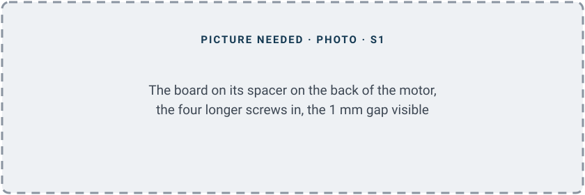
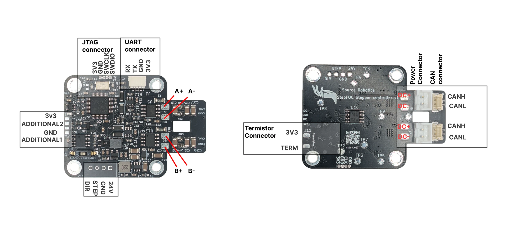

# 1. Fit the motor

The driver goes on the back of the motor, over a magnet on the motor's rear shaft.

## 1. Fit the magnet

1. Press the magnet onto the rear shaft, centred.
2. Glue it, so that it cannot turn on the shaft.

The magnet must end up about **1 mm** above the encoder chip in the middle of the board.

{ width="560" }

A magnet that slips is the usual cause of a calibration that "succeeds" and a motor that then runs badly.

!!! success "Check"
    The magnet sits centred on the shaft, and once the glue has set it does not move when you push it with a
    finger. If it does: [The encoder magnet](../04-mounting/magnet.md).

More: [The encoder magnet](../04-mounting/magnet.md).

## 2. Mount the board

1. Remove the motor's four rear screws.
2. Put the spacer on.
3. Put the board on the spacer, with the encoder chip towards the magnet.
4. Put the longer screws in.
5. Check the gap: 1 mm, not touching.

    { width="560" }

!!! success "Check"
    The board sits parallel to the back of the motor, about 1 mm above the magnet, and the shaft turns by hand
    without the magnet touching the chip. If not: [Mounting on the motor](../04-mounting/mounting.md).

More: [Mounting on the motor](../04-mounting/mounting.md).

## 3. Wire the motor

1. Find the two coils with a multimeter. The two wires of a coil show a few ohms; wires of different coils show
   nothing.
2. Solder one coil to **A+ and A−**.
3. Solder the other coil to **B+ and B−**.

Which coil is which, and which way round, does not matter: calibration detects it.

{ width="700" }

!!! success "Check"
    With the driver unpowered, a multimeter shows the coil's resistance, a few ohms, between A+ and A− and
    between B+ and B−, and no strand bridges two pads. If not: [Wiring the stepper](../04-mounting/wiring.md).

More: [Wiring the stepper](../04-mounting/wiring.md).
